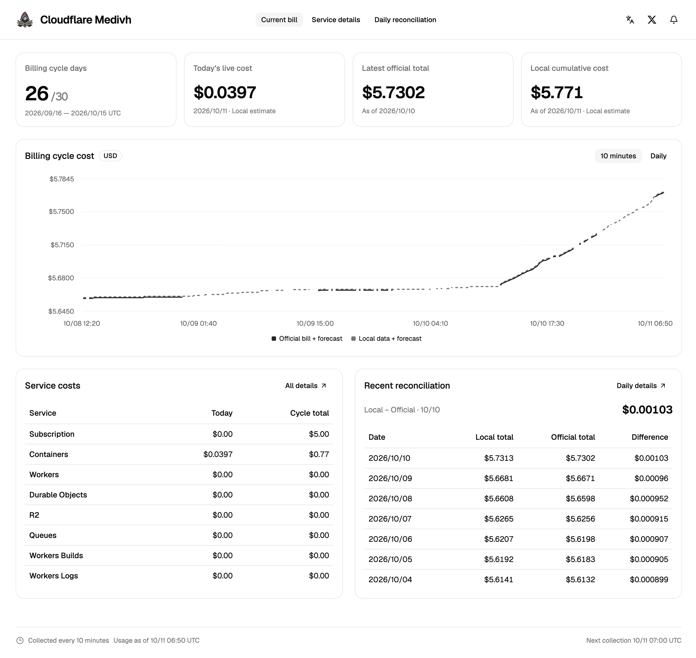
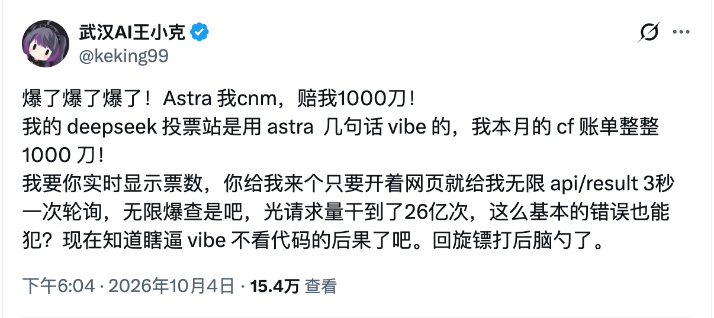
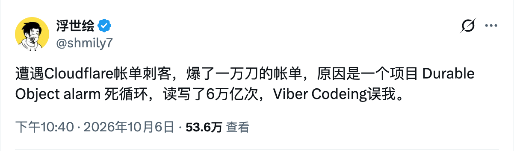

<p align="center">
  
</p>

<h1 align="center">Cloudflare Medivh</h1>

<p align="center">A self-hosted Cloudflare billing monitoring and usage analytics tool.</p>

<p align="center"><strong>English</strong> · <a href="./README.zh-CN.md">简体中文</a></p>



## Before you start

This project was built primarily through **vibe coding**. If that concerns you, please do not use it.

“Real-time billing” here is more accurately described as **near-real-time cost estimation**.

Medivh provides monitoring, reconciliation, and notifications. **It does not automatically stop Cloudflare services or enforce a spending cap.**

## Why this exists

Cloudflare's [Billable Usage API](https://blog.cloudflare.com/billable-usage-api/) updates daily; it is not a real-time billing API.

Bills do not necessarily update at exactly midnight UTC, either. Sudden spending spikes during the day can be hard to spot, and email alerts are easy to miss, particularly for users who rarely check email.

Some examples shared online:

[](https://x.com/keking99/status/2106687001810677911?s=20)

[](https://x.com/shmily7/status/2107481028726251762?s=20)

I decided to open-source my own monitoring service so others can use it as needed.

## How it works and its limitations

The core idea is simple:

```text
Official cumulative charges through yesterday + estimated charges added today ≈ current billing cycle cost
```

The formula is short. These are the issues behind it:

### P1. Official bills do not update on a fixed schedule

After midnight UTC, each collection round attempts to synchronize the official bill until it succeeds.

The last three days are also checked again for delayed or revised charges.

If yesterday's official data is still incomplete, the local cumulative estimate remains independently available when the usage data is complete.

### P2. Avoiding duplicate allowances and fixed charges

Free allowances shared across a billing cycle are applied once. Explicit daily allowances reset each day. Today's charge is calculated as the cumulative cost after adding today's usage minus the cumulative cost before adding it.

### P3. Unit-price precision in the official API

Some prices returned by the official API lack precision. Small differences can add up significantly.

Usage prices are therefore maintained in a central [price catalogue](server/src/constants/pricing.ts). This helps reduce estimation differences, but **prices do not automatically follow Cloudflare price changes**.

Each collection saves the prices and catalogue version it used for later reconciliation. Updating prices in the code does not rewrite existing snapshots.

### P4. Preserving evidence across interruptions and API failures

For the same meter and UTC window, Medivh prefers Cloudflare's official usage aggregates, including explicit zero values. It sums resource details only when an aggregate is unavailable. Storage usage is calculated from resource samples over time. Each new usage record includes a `quantitySource` marker. If neither source is available, collection is marked incomplete rather than treated as zero usage. Official bills remain a separate source for cost reconciliation.

Usage snapshots, daily reconciliation results, and notification state are stored in local SQLite. After a restart, the service attempts to backfill missing history.

### P5. The seven-day Workers Logs history gap

Cloudflare only exposes the last seven days of Workers Logs usage.

There is no complete workaround here: if you first start the service more than seven days into a billing cycle, this part of the historical backfill will be incomplete.

The combined estimate uses the official historical bill, which limits the impact of that missing local history. It does not restore the missing usage records.

## Features

| Feature              | Description                                                                                                                      |
| -------------------- | -------------------------------------------------------------------------------------------------------------------------------- |
| Current bill         | View cycle costs, today's increase, official historical totals, and local cumulative estimates                                   |
| Cost trends          | Switch between ten-minute collection curves and daily reconciliation curves to compare official adjustments with local estimates |
| Service details      | View usage, prices, free allowances, and costs by service and billing meter                                                      |
| Resource usage       | Compare usage curves for individual Workers, namespaces, applications, or buckets                                                |
| Daily reconciliation | Inspect daily cumulative costs and differences, with official revisions and calculation evidence retained                        |
| Feishu notifications | Send a summary after each collection round, or a failure notification when today's usage collection fails                        |
| Budget webhook       | Send an event to a configured endpoint when the current cycle cost exceeds a custom threshold                                    |
| Local persistence    | Preserve history, collection progress, and pending notifications across restarts                                                 |
| Agent queries        | Query billing summaries, service details, history, and resource usage through a read-only MCP endpoint                           |

Supported meters cover Workers (requests, CPU, Dynamic Workers), Workers Logs, Workers Builds, Containers, Durable Objects, R2, Queues, D1, and Workers KV.

Select a billing meter in the service details to view per-resource usage over time and totals for the selected window. The service trend page supports the last 48 hours and the current billing cycle. Resource names, usage buckets, and collection progress are written to SQLite by background jobs. Initial backfill retrieves available history for the current cycle; later runs incrementally update and correct recent data.

Pages only read SQLite. Refreshing or switching charts does not request Cloudflare data or trigger notifications. Usage and cost have separate charts and time-range controls. Legends let you show or hide totals and individual resources.

Usage totals use the same persisted meter records as the service table: cycle totals accumulate daily usage, while intraday totals use differences between adjacent collection snapshots. Missing intervals remain gaps. Chart totals are not independently reconstructed by summing resource curves. Resource details are collected separately and can differ from service totals because their coverage differs.

Resource costs are estimates allocated by cumulative usage share from local cumulative costs after free allowances. Costs without resource details are shown as unattributed. Official bills are displayed only as totals; free allowances are not deducted separately for every resource. Charts identify actual time resolution, retention limits, and unsupported breakdowns. Resource IDs are shown when permissions do not allow name lookup.

Keep these boundaries in mind:

- Accounting currently covers **one Cloudflare account within one billing cycle**. The account must have Billable Usage API coverage. Subscriptions with different cycles or currencies cannot currently be combined.
- Unsupported billed services or missing metrics are reported as incomplete data.
- Analytics may be delayed or sampled, so estimates can differ from official charges. Data older than the retention window cannot be fully recovered.
- Normal collection runs every ten minutes; notifications are not guaranteed at the instant a threshold is crossed.

## Getting started

### 1. Configure your account

Download the repository and create a configuration file in the project root:

```sh
# First setup only. If .env already exists, edit it instead of overwriting it.
cp .env.example .env
```

Set at least these two values:

```dotenv
CLOUDFLARE_API_TOKEN=your_API_Token
CLOUDFLARE_ACCOUNT_ID=your_Account_ID
```

Create a custom token under Cloudflare **My Profile → API Tokens**. Restrict account resources to the account you want to monitor and grant these permissions:

| Permission                           | Purpose                                                                                                                                                                                                                                                                                          |
| ------------------------------------ | ------------------------------------------------------------------------------------------------------------------------------------------------------------------------------------------------------------------------------------------------------------------------------------------------ |
| `Account > Billing > Read`           | Read bills, billing cycles, and subscriptions. See [billing permissions](https://developers.cloudflare.com/billing/understand/billing-permissions/).                                                                                                                                             |
| `Account > Account Analytics > Read` | Query usage statistics. See the [GraphQL API token guide](https://developers.cloudflare.com/analytics/graphql-api/getting-started/authentication/api-token-auth/).                                                                                                                               |
| `Workers Observability Write`        | Query Workers log counts. The [telemetry query API](https://developers.cloudflare.com/api/resources/workers/subresources/observability/subresources/telemetry/methods/query/) requires this permission even though this project only performs queries; a read-only permission cannot replace it. |

The token is used only on the backend and is never returned to the frontend. Do not commit `.env`.

### 2. Start the service

Choose Docker Compose or local Node.js, and keep one deployment running.

**Docker Compose**

Install Docker and Compose, then run this from the project root:

```sh
docker compose up -d --build --wait
```

Open <http://127.0.0.1:8788>. The image builds both the backend and frontend, so Node.js is not required on the host.

```sh
# View status and logs
docker compose ps
docker compose logs --tail 100 -f medivh

# Redeploy after changing .env or updating the code
docker compose up -d --build --wait
```

Compose binds to the local host by default. Data is stored in the `billing-data` volume and survives container rebuilds; `docker compose down -v` deletes this volume. Continuous collection requires the Docker engine to remain running.

**Local Node.js**

Requires **Node.js 24 or later**. Run from the project root:

```sh
npm run setup
npm run build
npm start
```

Open <http://127.0.0.1:8788> and keep the process running. Restart the service after changing `.env`.

The default local database is `data/billing.sqlite`, separate from the database in Docker's persistent volume. To preserve history and notification deduplication when switching deployment methods, stop the original collector first, then migrate a complete, consistent SQLite backup.

The first startup collects current usage and backfills the current billing cycle, which can take time. The page reads saved data every 30 seconds. Manual page refreshes do not trigger additional collection. If values remain pending reconciliation, check the failure reasons, pending dates, and service logs.

### 3. Configuration

| Variable                 | Description                                                                                                                     |
| ------------------------ | ------------------------------------------------------------------------------------------------------------------------------- |
| `CLOUDFLARE_API_TOKEN`   | Required Cloudflare API token                                                                                                   |
| `CLOUDFLARE_ACCOUNT_ID`  | Required ID of the account to monitor                                                                                           |
| `HOST`                   | Defaults to `127.0.0.1` locally; Compose sets `0.0.0.0` inside the container                                                    |
| `PORT`                   | Defaults to `8788` locally; Compose uses `8788`                                                                                 |
| `DATABASE_PATH`          | Defaults to `./data/billing.sqlite` locally, relative to the project root; Compose uses a persistent volume                     |
| `MCP_TOKEN`              | Optional fallback token for `/mcp`, at least 32 visible ASCII characters without whitespace; saved MCP settings take precedence |
| `MCP_ALLOWED_ORIGINS`    | Optional comma-separated exact HTTP(S) origins; empty rejects requests with an `Origin` header                                  |
| `FEISHU_WEBHOOK_URL`     | Optional Feishu group custom bot webhook; leave empty to disable Feishu notifications                                           |
| `FEISHU_SIGNING_SECRET`  | Optional signing secret when signature verification is enabled; requires a webhook URL                                          |
| `BUDGET_WEBHOOK_URL`     | Optional HTTP/HTTPS endpoint for budget-exceeded events                                                                         |
| `BUDGET_THRESHOLD_CENTS` | Optional positive integer threshold in cents; `30000` means USD 300. Configure together with the budget webhook.                |

The UI and `/api` routes, including token management, have no built-in authentication. MCP tokens protect only `/mcp`. Defaults are intended for local access. Configure authentication at the entry point if exposing the service externally.

For agent access, open Settings (the gear icon in the header), generate a token in the MCP section, and click **Save settings** to activate it. Copy the token while it is shown: the full value is available only during this page visit. Generation creates an unsaved draft; the old token remains valid until settings are saved, and the new token cannot be used yet. Refreshing or leaving the page discards unsaved changes. After saving, connect a Streamable HTTP MCP client to the displayed address, normally `http://127.0.0.1:8788/mcp`, with `Authorization: Bearer <MCP_TOKEN>`. No `.env` change or restart is needed. Disabling MCP also takes effect only after saving and remains in effect after a restart, even if `MCP_TOKEN` is set.

The endpoint runs in the existing backend and reads saved billing data without triggering collection. Existing deployments can continue using `MCP_TOKEN` until MCP is configured in Settings. See the [MCP setup guide](docs/mcp.md) for step-by-step setup, client configuration, verification, and troubleshooting ([简体中文](docs/mcp.zh-CN.md)).

### 4. Feishu notifications (optional)

Add a custom bot to the target group and configure its webhook on the Settings page (the gear icon in the header). If signature verification is enabled, also enter the signing secret. Environment variables `FEISHU_WEBHOOK_URL` and `FEISHU_SIGNING_SECRET` can still supply initial defaults. For keyword verification, you can use `Cloudflare`.

Once enabled, every successful collection round sends a summary, normally once every ten minutes, **even if the amount has not changed**. Messages include collection time, billing cycle, official bill plus estimate, local cumulative estimate, today's increase, and the change since the previous report.

That last change compares “local data + forecast” (`localTotal`) with the local cumulative amount in the last successfully sent summary. It retains six decimal places, shows negative changes and zero changes, and does not depend on official bill availability or adjustments. Missing local amounts are shown as pending reconciliation. The first report, a new billing cycle, or a currency change starts a new comparison baseline. The baseline is persisted across restarts; failed sends and collection-failure notifications do not update it. Feishu collection timestamps use Beijing time, while billing cycles remain in UTC.

If today's usage collection fails, a notification includes the reason and the last successful collection time, deduplicated within the same ten-minute slot. Failed messages stay queued for retry during later collection rounds. Confirmed successful messages are not resent. Historical backfills do not send individual summaries, and enabling notifications does not send older collection records retroactively.

### 5. Budget webhook (optional)

This feature is independent of Feishu. Enable it on the Settings page and enter the webhook and threshold in US cents. Alternatively, supply initial defaults in `.env`:

```dotenv
BUDGET_WEBHOOK_URL=https://example.com/hooks/billing
BUDGET_THRESHOLD_CENTS=30000
```

After restarting, a successful collection triggers the webhook when “official bill + forecast” (`currentTotal`) is **strictly greater than USD 300**. Equality does not trigger it. The threshold must be an integer number of cents, without decimals or negative values. Leaving both values empty disables the feature; setting only one causes a startup error.

- Applies only to USD billing cycles. Pending reconciliation, collection failures, and historical backfills do not trigger it. It does not fall back to the local cumulative estimate.
- Only one event is created per cycle, preserving the amount, threshold, and timestamp of the first crossing. After successful delivery, another crossing, a restart, or a threshold change does not resend it within the same cycle.
- Only HTTP 2xx counts as success. Requests time out after ten seconds and do not follow redirects. Failures retry within the current job at one-second intervals until successful or the service stops.
- **Continuous retries keep the current collection job running and delay subsequent collection.** Saved data remains available. Pending events resume after a restart.
- Requests include an `Idempotency-Key`. Receivers should deduplicate using that key to avoid duplicate processing when a response is lost.

<details>
<summary>Example webhook request</summary>

The request is a JSON POST. `Idempotency-Key` matches the body's `id`:

```json
{
  "kind": "budget_exceeded",
  "id": "budget:<SHA-256 of the billing cycle ID>",
  "cycle": {
    "id": "2026-10-01:2026-11-01",
    "start": "2026-10-01",
    "end": "2026-11-01",
    "currency": "USD"
  },
  "observedAt": "2026-10-09T04:00:00.000Z",
  "metric": "currentTotal",
  "thresholdCents": 30000,
  "amountUsd": 301.25
}
```

`cycle.end` is exclusive. The last billing day in this example is October 31.

</details>

### 6. Development and manual collection

The backend uses Node.js, TypeScript, Koa, and SQLite. The frontend uses React, React Router, shadcn/ui, and Recharts.

```sh
npm run dev          # Start backend and frontend development servers
npm test             # Run backend and frontend calculation tests
npm run check        # Backend type checking and frontend build
npm run format:check # Check code and documentation formatting

# Collect once manually; also triggers configured notifications
npm --prefix server run collect

# Manual collection in Docker
docker compose exec medivh node server/dist/collect.js
```

In development, open <http://127.0.0.1:5173>. The frontend proxies API requests to backend port `8788`. The backend provides `GET /api/dashboard` and `GET /api/health`.

For implementation details, see [Cloudflare data and billing semantics](docs/cloudflare-api.md), the [frontend directory guide](web/README.md), and the [usage price catalogue](server/src/constants/pricing.ts). The linked guides are currently in Chinese.

## A few closing thoughts

### Why Medivh?

The name comes from Medivh in Warcraft: a guardian, with a hint of a warning bearer—even if that guardian caused the trouble himself.

Hopefully, this time he can protect our wallets.

### Waiting for an official solution

In its [October 2, 2026 update](https://blog.cloudflare.com/enterprise-for-all-update/), Cloudflare said it was working on hard spending caps, with early availability planned for **Q4 2026**.

Please ship them soon so everyone can sleep a little better. Until then, this gives your bill another layer of alerts.

### Why not automatically disable services?

Some services are easy to disable, while others require preparation in application logic, such as Durable Objects. Everyone's response will differ, too.

When separating this project from my own setup, I decided to provide monitoring and alerts only. The webhook lets users implement their own response for their business scenario, rather than relying on a universal shutdown action.

### Feedback welcome

My own usage scenarios are limited. Different plans, product combinations, and cycle boundaries need more real-world validation. Issues and pull requests are welcome, especially for billing differences, missing service metrics, and collection failures.

### Who am I?

I'm jinyang1994. Find me on [X](https://x.com/jinyang1994)—happy to chat.
